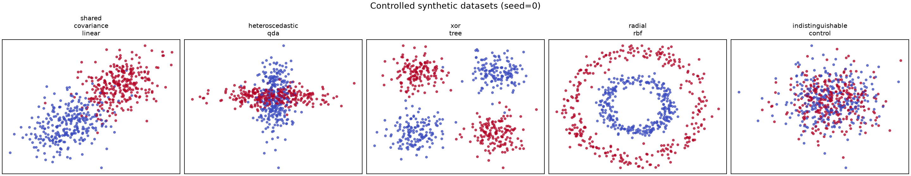
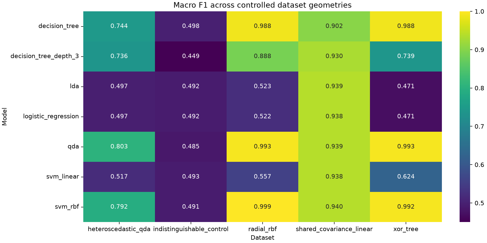
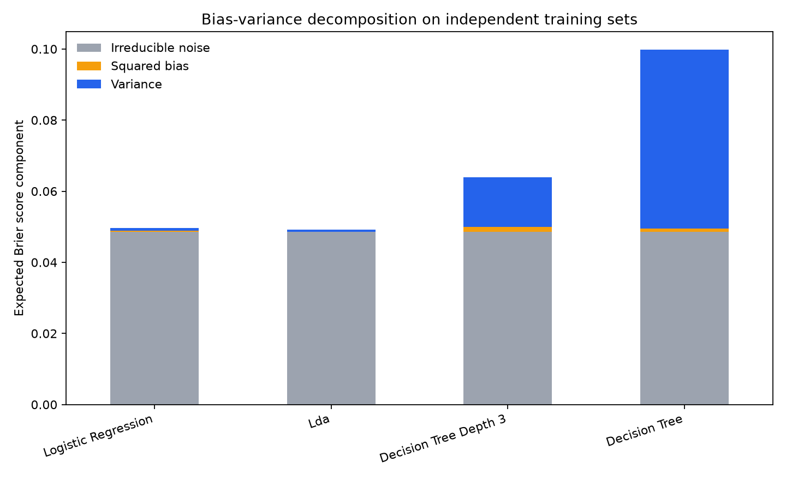
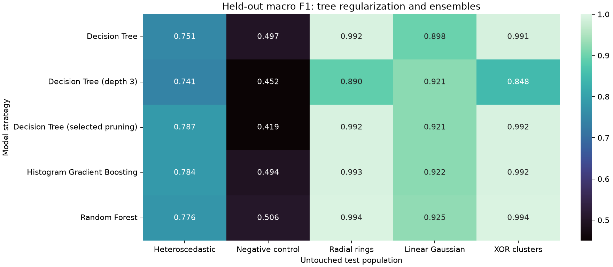

# Classifier Behavior on Controlled Synthetic Data

A reproducible laboratory for studying how the inductive assumptions of
classical classifiers interact with geometry, covariance, noise and class
separability.

This project began as a master's-level Machine Learning assignment. The
original notebook is preserved as legacy evidence; the current implementation
turns its strongest idea into a controlled, tested and table-driven experiment.

## Research question

> How do classifier assumptions interact with deliberately designed data
> geometries, and where do those assumptions help or fail?

The goal is not to declare one universal winner. Each dataset is designed to
expose a different kind of decision boundary or provide a negative control.



## Controlled experiment

| Dataset | Intended role |
| --- | --- |
| `shared_covariance_linear` | Gaussian classes compatible with linear and shared-covariance boundaries |
| `heteroscedastic_qda` | Classes distinguished mainly by different covariance geometry |
| `xor_tree` | XOR clusters requiring nonlinear or quadratic interactions |
| `radial_rbf` | Concentric rings that cannot be separated by a straight line |
| `indistinguishable_control` | Both labels sampled from the same distribution; expected chance performance |

Seven classifiers are evaluated on identical repeated stratified folds:

- Logistic Regression
- Linear Discriminant Analysis (LDA)
- Quadratic Discriminant Analysis (QDA)
- Decision Tree
- Depth-limited Decision Tree
- Linear SVM
- RBF SVM

Scale-sensitive models use fold-local pipelines, preventing preprocessing
leakage. The published baseline uses five independently generated datasets per
geometry, with 5-fold cross-validation repeated three times for each seed.

## Baseline results



Selected mean macro F1 values, aggregated first within each generated dataset
and then across five independent data seeds:

| Dataset | Strongest observed model | Mean macro F1 | Std. across seeds |
| --- | --- | ---: | ---: |
| Shared covariance linear | RBF SVM | 0.9396 | 0.0070 |
| Heteroscedastic covariance | QDA | 0.8032 | 0.0134 |
| XOR clusters | QDA | 0.9927 | 0.0012 |
| Radial rings | RBF SVM | 0.9986 | 0.0005 |
| Indistinguishable control | Decision Tree | 0.4983 | 0.0221 |

The shared-covariance result is effectively a tie among several models rather
than evidence that RBF SVM is generally superior. QDA's strong XOR and radial
scores are also meaningful: quadratic decision functions can express cross
terms and covariance-driven curved boundaries. The negative control remaining
near 0.5 is an essential sanity check.

Full evidence is stored in:

- [`results/modern/metrics.csv`](results/modern/metrics.csv): 2,625 fold-level observations;
- [`results/modern/summary.csv`](results/modern/summary.csv): means and seed-level dispersion;
- [`results/modern/metadata.json`](results/modern/metadata.json): versions and protocol;
- [`notebooks/analysis.ipynb`](notebooks/analysis.ipynb): short narrative exploration.

## Corrected bias-variance experiment

The legacy notebook's bias-variance block reused one already fitted tree, so it
could not observe variation caused by changing the training sample. The modern
experiment instead fits each model on 100 independently generated training
sets and evaluates them on a separate population of 10,000 observations.

Because the Gaussian data generator has an analytic class posterior, the
expected Brier score can be separated exactly into irreducible noise, squared
bias and variance.



| Model | Squared bias | Variance | Expected Brier |
| --- | ---: | ---: | ---: |
| Logistic Regression | 0.000347 | 0.000708 | 0.049585 |
| LDA | 0.000025 | 0.000669 | 0.049223 |
| Decision Tree, depth 3 | 0.001496 | 0.013877 | 0.063901 |
| Decision Tree, unrestricted | 0.001001 | 0.050341 | 0.099871 |

The unrestricted tree's variance is substantially larger in this controlled
problem; limiting depth reduces it. This is a Brier-score decomposition for
probability estimates, not a decomposition of accuracy. See the full
[protocol and interpretation](docs/BIAS_VARIANCE.md).

## Tree regularization and ensembles

A second experiment keeps model selection separate from final evaluation. For
each data seed, cost-complexity pruning is selected on a dedicated validation
population, then all strategies are evaluated once on an independently
generated test population.



Selected observations from five independent test populations:

- pruning raises mean macro F1 from `0.751` to `0.787` on the
  heteroscedastic problem;
- Random Forest reaches `0.994` on both XOR and radial geometries;
- fixed depth 3 underfits the radial and XOR geometries;
- the negative control exposes pruning-selection instability: two refitted
  trees collapse to a single node, while the other strategies remain around
  chance.

This last result is a useful warning: validation can select noise when no
predictive structure exists. The complete protocol and limitations are in the
[regularization and ensemble record](docs/REGULARIZATION_ENSEMBLES.md).

## Reproduce the modern baseline

Validated on Windows 11 with Python 3.12.10.

```powershell
git clone https://github.com/Onirb/ml-methods-comparison.git
cd ml-methods-comparison
python -m venv .venv
.\.venv\Scripts\python.exe -m pip install -r requirements.txt
.\.venv\Scripts\python.exe -m pip install --no-deps -e .
.\.venv\Scripts\python.exe -m pytest
.\.venv\Scripts\python.exe -m scripts.run_experiments
.\.venv\Scripts\python.exe -m scripts.run_bias_variance
.\.venv\Scripts\python.exe -m scripts.run_regularization
```

The run regenerates compact CSV, JSON and PNG evidence under
`results/modern/`. It does not download an external dataset or call an online
model provider.

## Legacy reproduction

The original assignment is preserved at
[`notebooks/Assignment_legacy.ipynb`](notebooks/Assignment_legacy.ipynb).
It was executed from top to bottom in a separate compatibility environment:

```powershell
python -m venv .venv-legacy
.\.venv-legacy\Scripts\python.exe -m pip install -r requirements-legacy.txt
```

The clean execution completed without cell errors, but that only establishes
that the code path still runs. It does not validate the historical methodology.
In particular, the original bias-variance block repeats predictions from one
already fitted tree instead of fitting models on independent samples.

See the [legacy reproduction record](docs/LEGACY_REPRODUCTION.md) and the
[methodology audit](docs/METHODOLOGY_AUDIT.md).

## Repository layout

```text
src/ml_methods_comparison/   Dataset generators, models and evaluation
scripts/run_experiments.py   Reproducible baseline command
scripts/run_bias_variance.py Corrected Brier-score decomposition
scripts/run_regularization.py Held-out pruning and ensemble study
tests/                       Fast deterministic checks
notebooks/analysis.ipynb     Narrative view of generated evidence
notebooks/*_legacy.ipynb     Preserved original assignment
results/modern/              Compact published baseline evidence
docs/                        Audit, reproduction record and next steps
```

## Scientific limits

- These are controlled synthetic demonstrations, not a benchmark for all
  real-world classification tasks.
- Model hyperparameters are fixed; the experiment studies behavior under this
  protocol rather than exhaustive tuning.
- Repeated folds within one generated dataset are not treated as independent
  uncertainty samples; dispersion is reported across independent data seeds.
- The bias-variance result is specific to the stated Gaussian generator and
  Brier score.
- The pruning and ensemble results use fixed synthetic geometries and five
  seeds; they are explanatory experiments rather than universal rankings.

The next bounded tasks are recorded in [`docs/NEXT_STEPS.md`](docs/NEXT_STEPS.md).
